<p align="center">
  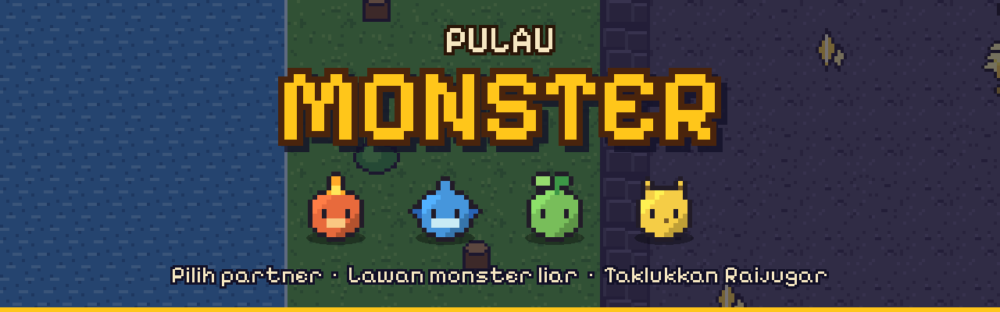
</p>

<p align="center">
  
  
  
  
  
</p>

> **Nama:** M. Reihan Fahreza<br>
> **NIM:** 4352511014<br>
> **Mata kuliah:** Proyek Game 2D, seri 7 pertemuan (P1–P7)<br>
> **Kampus:** Politeknik Negeri Batam, Program Studi Teknologi Permainan<br>
> **Branch:** `MReihanFahreza_4352511014`

---

## 🏝️ Selamat Datang di Pulau Monster

Di ujung Pulau Batam ada desa kecil tempat manusia dan monster hidup berdampingan. Hari ini kamu cukup umur untuk memilih **partner pertamamu**.

Temui **Tetua Rahmat**, pilih satu dari tiga starter, lalu lewati Penjaga Batas menuju hutan. Monster liar di rumput tinggi akan mengejarmu. Menangkan battle, kumpulkan EXP, saksikan partnermu **berevolusi**, sampai akhirnya berhadapan dengan **Raijugar**, penguasa Gua Petir.

<p align="center">
  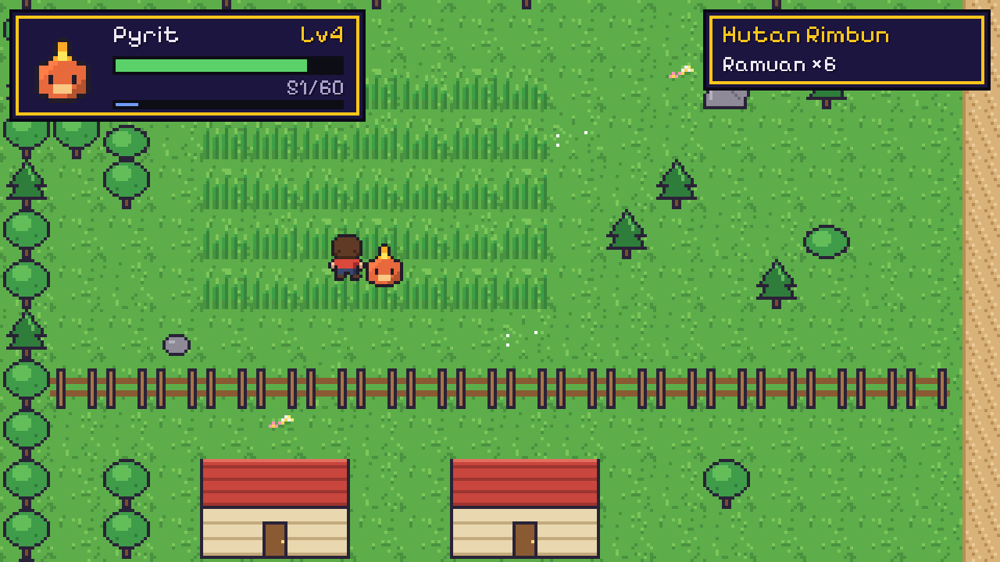
</p>

## 🐾 Monster & Evolusi

Dua belas monster, empat elemen, tiga tahap. Partner berevolusi di **Lv 5** dan **Lv 9**.

| Elemen | Tahap 1 | Tahap 2 · Lv 5 | Tahap 3 · Lv 9 | Jurus | Kuat lawan |
|:---:|:---:|:---:|:---:|---|:---:|
| 🔥 **Pyro** | <br>Pyrit | 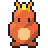<br>Pyrago | 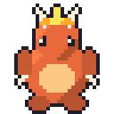<br>Infernox | Semburan Api | 🌿 Sprout |
| 💧 **Aqua** | <br>Blubi | <br>Finnox | 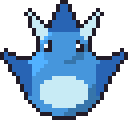<br>Tidalord | Tembakan Air | 🔥 Pyro |
| 🌿 **Sprout** | <br>Sprig | 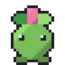<br>Bloomlet | 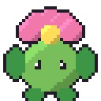<br>Florazor | Daun Tajam | 💧 Aqua |
| ⚡ **Volt** | <br>Zapi | 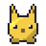<br>Voltcat | 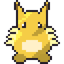<br>Raijugar | Setrum Kilat | 💧 Aqua |

Jurus yang kuat melawan elemen lawan memberi damage **×1,5** ("Sangat efektif!"), arah sebaliknya **×0,75**. Starter yang ditawarkan Tetua: **Pyrit**, **Blubi**, dan **Sprig**, semuanya mulai di Lv 3.

## 🗺️ Peta Pulau

Satu peta 40 × 36 tile, dibangun dengan empat Tilemap berlapis dan Rule Tile.

<p align="center">
  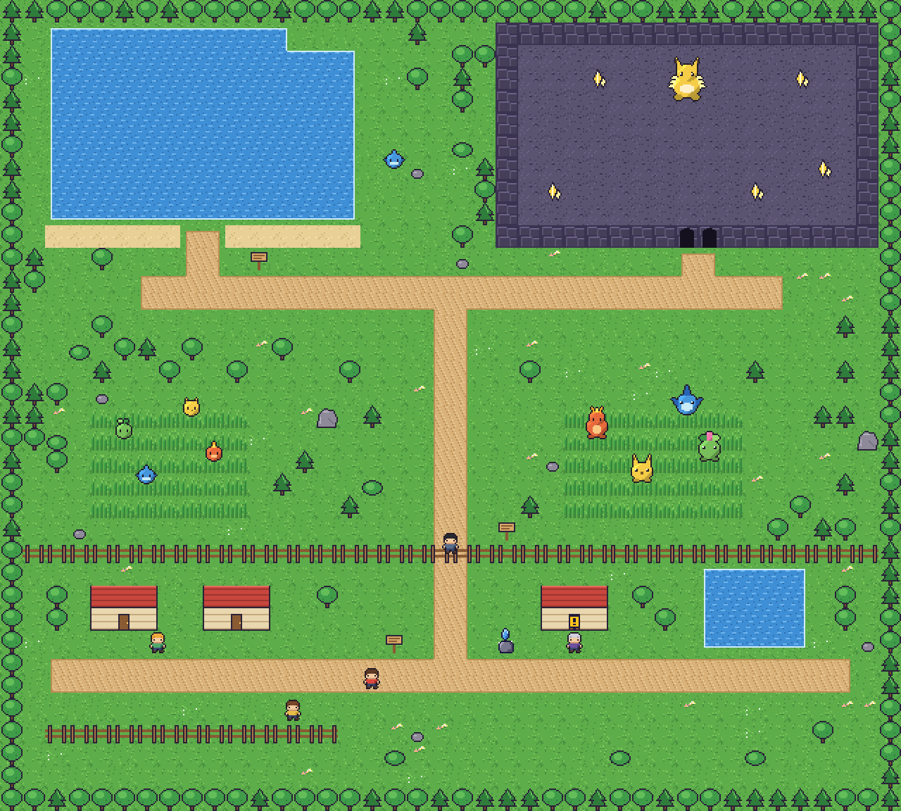
</p>

| Area | Letak | Isi |
|---|:---:|---|
| 🏡 **Desa Awal** | selatan | 3 rumah, kolam, Tetua Rahmat, Sari, Pak Dagang, Batu Simpan, pagar dengan satu celah |
| 🌲 **Hutan Rimbun** | tengah | Rumput tinggi barat (Sprig, Zapi, Blubi, Pyrit · Lv 2–4) dan timur (Pyrago, Finnox, Voltcat, Bloomlet · Lv 5–7) |
| 🌊 **Danau Sunyi** | barat laut | Danau besar dan Blubi liar · Lv 4–6 |
| ⚡ **Gua Petir** | timur laut | Gua gelap, lima kristal bercahaya, dan boss **Raijugar · Lv 9** |

<p align="center">
  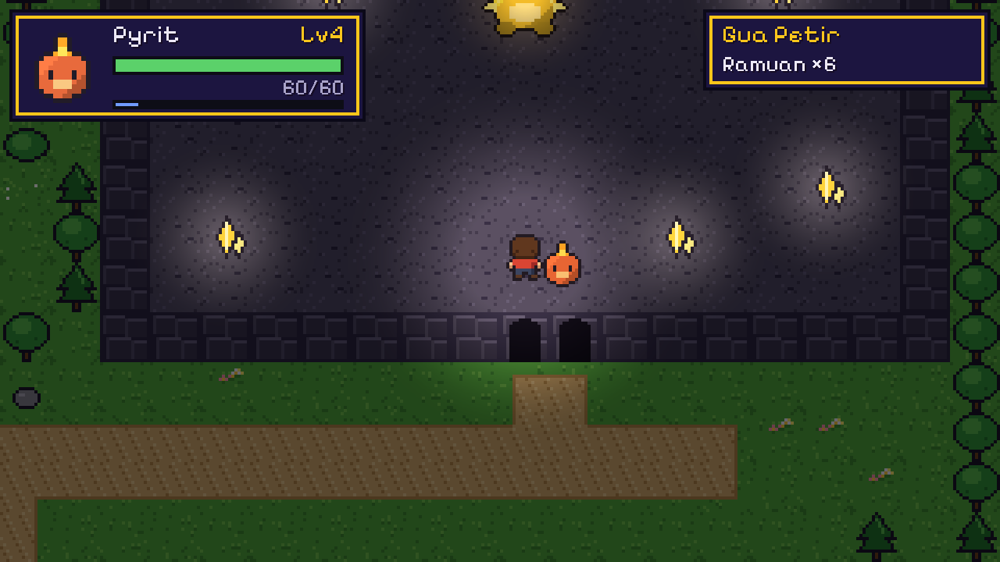
  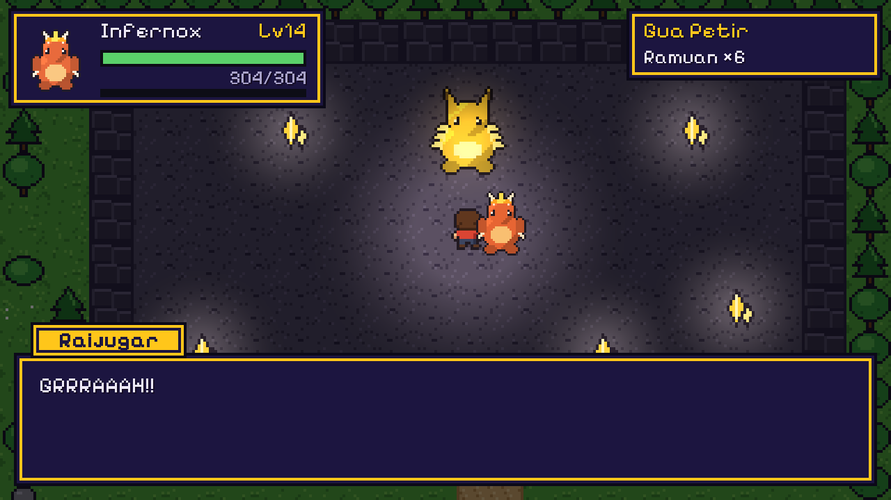
</p>

## ⚔️ Battle Bergiliran

Sentuh monster liar dan layar berpindah ke arena battle. Urutan giliran ditentukan oleh **Speed**, kecuali Ramuan dan Kabur yang selalu jalan duluan.

| Aksi | Efek | Catatan |
|---|---|---|
| ⚔️ **Serang** | Power 14 | Meleset 6%, kritis 8% (×1,5) |
| ✨ **Jurus** | Power 22 × elemen | 3 kali per battle |
| 🧪 **Ramuan** | Pulih 40% HP | Dapat 3 di awal, +3 dari Pak Dagang |
| 🏃 **Kabur** | 70% berhasil | Tidak bisa kabur dari Raijugar |

Menang memberi **EXP = (10 + Lv lawan × 8)**, dua kali lipat untuk boss. Kalah? Kamu kembali ke depan Batu Simpan dengan partner yang sudah pulih.

<p align="center">
  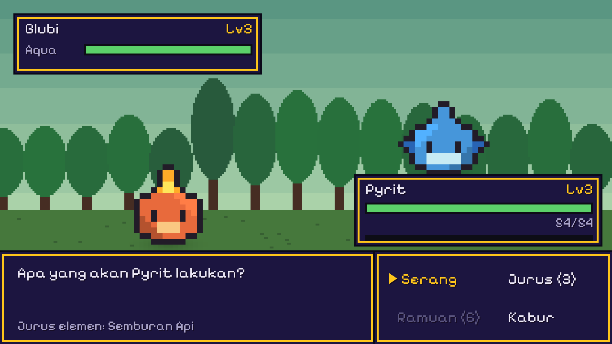
  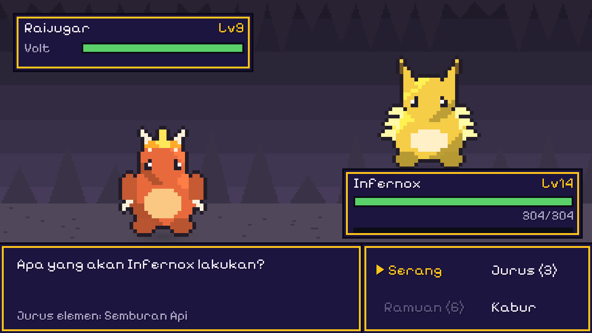
</p>

## 🎮 Kontrol

| Tombol | Aksi |
|:---:|---|
| `W` `A` `S` `D` / panah | Berjalan |
| `Shift` (tahan) | Lari |
| `E` | Bicara dengan NPC / Batu Simpan |
| `E` `Spasi` `Enter` `Z` / klik | Pilih menu, lanjut dialog |
| `Esc` `X` `Backspace` | Batal · `Esc` membuka menu jeda |
| `M` | Suara hidup / mati |

## ✨ Fitur

- **Dialog bercabang:** pilih partner, jawab "Yakin?", lalu Ya atau Pilih lagi. Teks diketik huruf demi huruf.
- **Batu Simpan:** memulihkan partner dan menyimpan perjalanan ke `save_0.json`. Layar judul punya menu **Lanjutkan**.
- **Menu jeda (Esc):** Lanjut, Simpan sekarang, atau Kembali ke judul.
- **Musik per area** untuk desa, hutan, battle, dan boss. Tekan `M` untuk mute.
- **Cahaya 2D:** gua menjadi gelap, sementara cahaya pemain, kristal, dan Raijugar menyala.
- **Game feel:** tebasan, percikan warna elemen, guncangan layar, hit-stop, kilau saat naik level, dan angka damage melayang.
- **Ending:** narasi penutup lalu layar **DEMO SELESAI** dengan partner, level, dan waktu bermain.

<p align="center">
  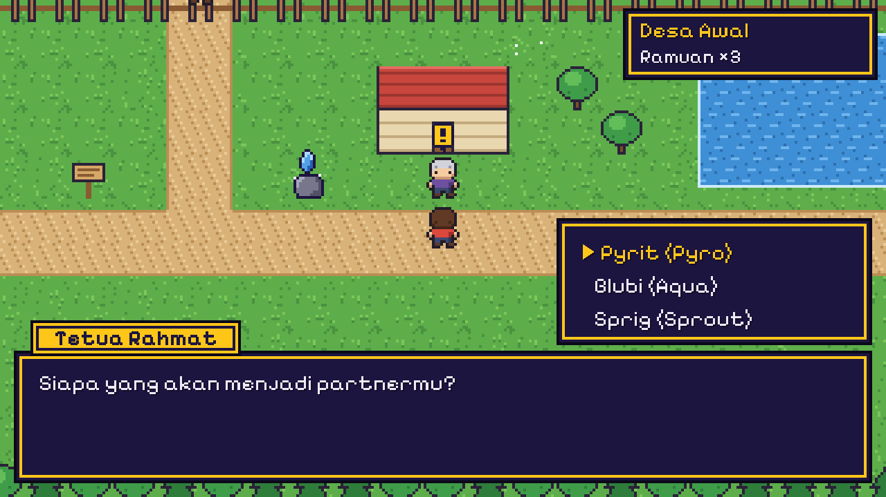
  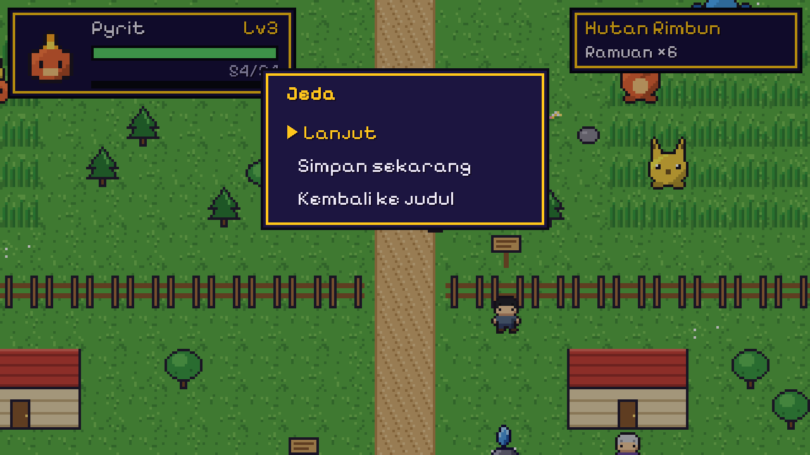
</p>
<p align="center">
  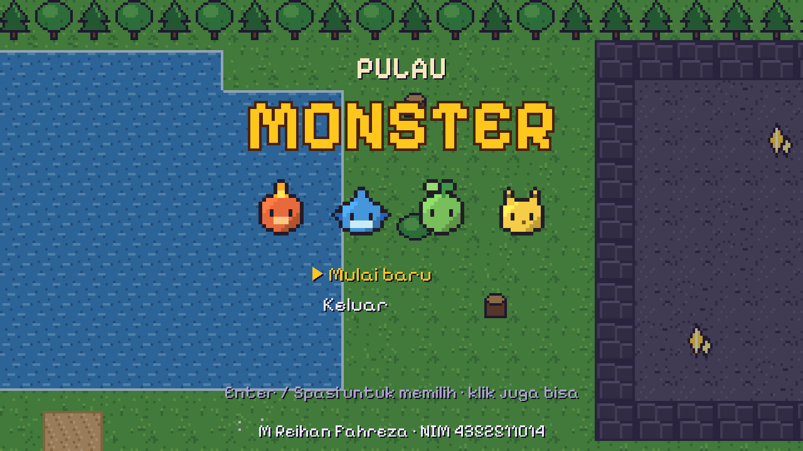
  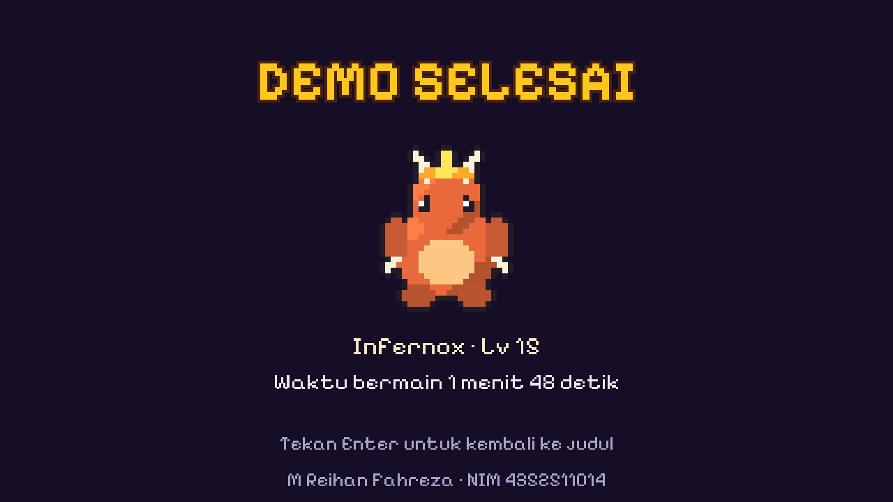
</p>

## 📚 Isi per Pertemuan

| P | Topik | Hasil di game |
|:---:|---|---|
| 1 | Setup Proyek & Gerak Karakter | Repo + Git LFS, folder `_Project`, preset pixel art, Player berjalan dengan Rigidbody2D, scene sandbox |
| 2 | Arsitektur & World Tilemap | `PlayerConfig`, `IMoveInput`, `Scn_Bootstrap` + Composition Root, peta 40 × 36, Rule Tile, sorting top-down |
| 3 | Animasi, Kamera & Interaksi | Blend Tree 4 arah, Cinemachine + Confiner 2D, tombol interaksi, 4 NPC dari satu prefab |
| 4 | Data Monster & Monster Liar | 12 `MonsterData` dari CSV, level & evolusi, FSM monster liar, perpindahan ke `Scn_Battle` |
| 5 | Battle & UI | `BattleSystem` bergiliran, 4 `BattleAction`, MVP, tema UI navy-emas, HUD partner |
| 6 | Dialog, Save & Audio | `DialogueRunner`, NPC turunan, story flag, save JSON, layar judul, menu jeda, audio |
| 7 | Polish, Build & Demo | Cahaya gua, partikel piksel, `BattleFeel`, ending + `Scn_End`, build `.exe` |

Tugas tambahan tiap pertemuan juga dikerjakan, antara lain sprint, sudut dalam Rule Tile, `FleeState`, angka damage melayang, dan dialog Sari yang berubah setelah boss kalah.

## 🧱 Arsitektur

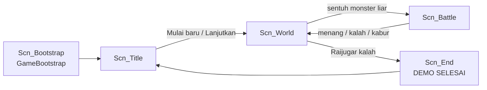

- **Composition Root & Dependency Injection:** semua service dibuat di `GameBootstrap`, lalu dibagikan ke scene lewat `SceneInstaller.Install()`.
- **ScriptableObject:** `Cfg_Player`, 12 `Mon_*`, `MonsterDatabase`, dan `DialogueData` memisahkan data dari logika.
- **Interface & Decorator:** `IMoveInput`, `IActionInput`, dan `IInteractable`. `InputGate` mengunci input saat dialog, battle, dan menu jeda.
- **Finite State Machine:** monster liar berpindah Wander → Chase → Return, plus Flee.
- **MVP + event:** `BattleSystem` (logika) → `BattlePresenter` → `BattleView` / `MonsterPanel` (tampilan).
- **Inheritance:** `Npc.Talk()`, `BattleAction`, dan `SceneInstaller` dipakai ulang oleh turunannya.
- **Object Pool:** `PixelBurst` (Stack) dan `VfxPool` (`ObjectPool<T>`).

## 🚀 Cara Menjalankan

1. Clone branch ini (Git LFS wajib terpasang).
   ```bash
   git lfs install
   git clone -b MReihanFahreza_4352511014 https://github.com/reihanfahreza/game_2D_Proj1.git
   ```
2. Buka folder project lewat Unity Hub dengan **Unity 6000.3.24f1**.
3. Tekan **Play**. Scene apa pun yang terbuka, game selalu mulai dari `Scn_Bootstrap`.
4. Untuk membuat `.exe`, pilih menu **Pulau Monster → Build Windows (.exe)**. Hasilnya ada di `Builds/PulauMonster_Win/PulauMonster.exe`.

<details>
<summary><b>📐 Kesepakatan tim (P1)</b></summary>

**Lingkungan**
- Unity 6000.3.24f1 (JANGAN upgrade). Modul memakai 6000.6.0f1; project ini dibuat dengan versi yang terpasang, dan semua fitur modul berjalan di versi ini.
- Template Universal 2D, Input System (project-wide actions), Cinemachine 3.1.7, 2D Tilemap Extras.

**Alur kerja**
- Branch per anggota: `NamaLengkap_NIM` → `MReihanFahreza_4352511014`
- Commit: `feat:` / `fix:` / `art:` / `chore:` / `docs:` + ringkasan
- Fetch → Update from main → kerja → tutup Unity → commit → push → PR

**Aturan kode**
- Class & method: PascalCase
- Field private: camelCase + `[SerializeField]`

</details>

<details>
<summary><b>🗂️ Struktur folder</b></summary>

```
Assets/_Project/
  Art/        Backgrounds, Characters, Fonts, Monsters, Tiles (+Palette), UI, VFX, Animations
  Audio/      BGM, SFX
  Data/       MonsterDatabase.csv, Mon_*.asset, MonsterDatabase, Cfg_Player, Dialogue
  Editor/     PlayFromBootstrap, DemoBuilder
  Prefabs/    NPC, Monsters, Fx
  Scenes/     Scn_Bootstrap, Scn_Title, Scn_World, Scn_Battle, Scn_End, Sandbox/Scn_Reihan
  Scripts/    Core (Input, Bootstrap, Fsm, Save, Audio, Story), Player, World, Monsters, Battle, UI, Dialogue, Fx, Dev
  Settings/   Presets/Pre_PixelSprite
Docs/         Gambar README
```
Scene List build: 0 Bootstrap · 1 Title · 2 World · 3 Battle · 4 End.

</details>

<details>
<summary><b>🛠️ Alat bantu</b></summary>

- **Pulau Monster → Rakit Ulang Semua** membuat ulang tile, animasi, data monster, prefab, dan semua scene dari Starter Asset Pack (`DemoBuilder`).
- **Pulau Monster → Render Peta untuk README** membuat `Docs/peta.png`.
- `PulauMonster.exe -autopilot` memainkan alur demo secara otomatis, lalu menyimpan screenshot dan `report.txt` di `AppData/LocalLow/Politeknik Negeri Batam/Pulau Monster/autopilot`.
- `PulauMonster.exe -recordvideo` memainkan dan merekam potongan demo (frame JPG + audio WAV) ke folder `video` di lokasi yang sama, untuk dirangkai menjadi video demo dengan ffmpeg.
- Di Editor atau Development Build, saat battle: `F1` membuat HP lawan tinggal 1, `F2` membuat HP partner tinggal 1.

</details>

## 🙏 Kredit

- **Starter Asset Pack** mata kuliah Proyek Game 2D (sprite, tile, UI, VFX, audio, `MonsterDatabase.csv`).
- **Pixelify Sans**, SIL Open Font License 1.1 (`Assets/_Project/Art/Fonts/PixelifySans_OFL.txt`).

---

<p align="center"><b>Pilih partnermu. Latih di rumput tinggi. Tundukkan Raijugar.</b></p>
